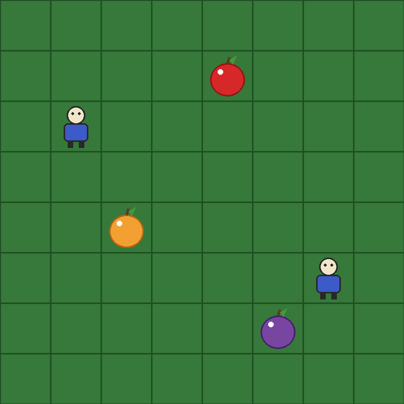

# Level-Based Foraging

A two-player, fully cooperative Level-Based Foraging grid in the forced-cooperation
variant of [lb-foraging](https://github.com/semitable/lb-foraging), re-implemented
in `core.py` with one addition: every food item has a type that both agents can see.
Collecting an item needs both agents next to it, loading at the same time, so the two
agents have to agree on which item to collect. The uncollected items play the role of
the alternative recipes in Overcooked.

<p align="center"></p>

| | value (config `config/lbf_fc_3type.yaml`) |
|---|---|
| grid | 8 x 8 |
| agents | 2 |
| item types | 3 |
| items per episode | 3, one of each type |
| horizon | 40 in the config; the training and evaluation scripts pass `--horizon 80`, which is the value used in the paper |
| observation size | 22 |
| actions | 6 |

## Episode

At reset (`LBFCore.reset`):

- Agent 0 spawns on a random cell of the left half of the grid (columns 0 to 3),
  agent 1 on the right half (columns 4 to 7).
- The three types are shuffled and one item of each type is placed on a random free
  cell that has at least one free neighbouring cell.

Movement (`UP`, `DOWN`, `LEFT`, `RIGHT`) into a wall, an item, or the other agent is
blocked. If both agents target the same cell, or try to swap cells, neither moves.
`NOOP` does nothing.

An item is collected when, in the same step, both agents issue `LOAD` and both are
orthogonally adjacent to that item (`core.py`, `step`). The episode ends as soon as
an item is collected, or at the horizon. Items that are not collected stay on the
grid; they are distractors that create the coordination problem.

## Action space

Six discrete actions, indices 0 to 5: `NOOP`, `UP`, `DOWN`, `LEFT`, `RIGHT`, `LOAD`.

## Observation space

A 22-dimensional vector per agent (`core.py`, `_observe`), all entries in [0, 1]:

| block | size |
|---|---|
| own position (row / 8, column / 8) | 2 |
| other agent's position | 2 |
| per item (3): position (2), present flag (1), one-hot type (3) | 3 x 6 = 18 |
| **total** | **22** |

The type one-hot of an item is zeroed once the item is collected.

## Reward

Both agents receive the same reward: +10 when an item is collected
(`complete_reward`) and -0.1 at every step (`step_cost`). The config also has an
`align_reward` term (bonus when both agents are next to an item within
`align_window` steps of each other); it is 0 in every experiment.

## Rule-based level-0 partners

`policy.py`, class `LBFRuleBasedPolicy`. A level-0 partner is assigned one item type
and ignores the other items. At every step it

1. finds the nearest uncollected item of its type (Manhattan distance), or does
   nothing if none is left;
2. issues `LOAD` if it is orthogonally adjacent to that item;
3. otherwise takes a greedy move towards a cell adjacent to the item.

Two optional noise knobs: `nav_p` (probability of preferring the horizontal move) and
`rand_p` (probability of a random move instead of the planned one). The pools in the
paper use `--p 0`, so the partners are deterministic.

The level-0 pool (`get_train_eval_pool`) has one partner per type:
`--train-pool-size 3 --eval-pool-size 3` with `--lbf-num-fruit-types 3`.

## Pretrained level-1 partners

Level-1 checkpoints are loaded with `get_train_eval_l1_pool_lbf` through the same
flags as the Overcooked recipe-subset loader:

```
--use-l1-specialized --l1-specialized-train "L1_FC_h80:1,2" --l1-specialized-eval "L1_FC_h80:3"
```

The spec is `TAG:seed,seed;TAG:seed`, where `TAG` is a directory under the pool base
directory (`--l1-specialized-base-dir`, default `logs/LBF/ppo_june_new_exp` under the
repository root; the release scripts pass `logs/LBF/ppo_LBF/{side}/L1`). The checkpoint is
`{base}/{TAG}/seed{N}_seed{N}/ppo/` (or `seed{N}/ppo/`) with `latest.pt`, `30000000.pt` or
`individual_latest.pt`. `--lbf-horizon 80` sets the length of the partner's history buffer and
must match `--horizon`. `--lbf-l1-eval-spec` adds level-1 partners to the evaluation pool of a
run that trains against level-0 partners.

## Configuration files

| file | use |
|---|---|
| `config/lbf_fc_3type.yaml` | the environment described above; all LBF training and evaluation |
| `config/lbf_fc_test.yaml` | 5 x 5 grid, 2 items, horizon 30; smoke test only (`scripts/lbf/smoke_test.py`) |

Keys: `grid_size`, `horizon`, `num_agents`, `num_fruit_types`, `num_fruits_per_episode`,
`present_types` (`null` = one item of each type), `complete_reward`, `step_cost`,
`align_reward`, `align_window`. `LBFMaker` (`lbf_maker.py`) builds the environment
from the config; `LBF_SingleEnv` (`lbf_single.py`) is the single-agent wrapper that
holds the partner. `render_ascii()` prints the grid with items as their type index
and the agents as `A` and `B`.
