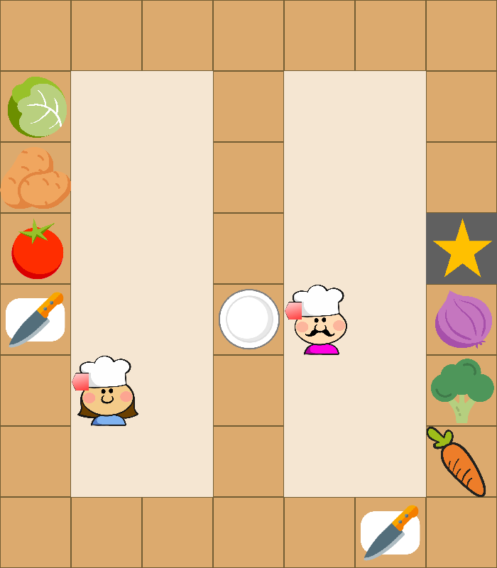
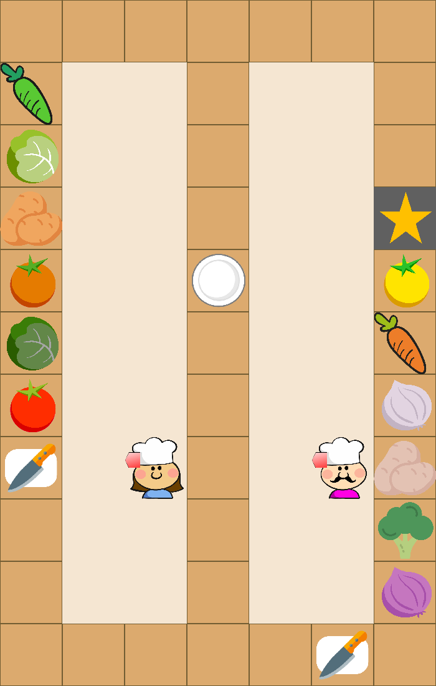

# Overcooked

A two-player cooperative kitchen based on the multi-recipe, forced-coordination
Overcooked of [Charakorn et al.](https://github.com/51616/marl-lipo) (gym_cooking).
The two agents stand on opposite sides of a counter that divides the kitchen. Each
raw ingredient is reachable from one side only, so every dish needs one ingredient
from each agent, and only the right-hand agent can reach the delivery square.

Two versions of the kitchen are used. They share all mechanics and differ in the
map size, the number of recipes, and the horizon.

| | 3-recipe kitchen | 6-recipe kitchen |
|---|---|---|
| config | `config/fc_small_test.yaml` | `config/fc_small_6recipe_h80.yaml` |
| level file | `gym_cooking/utils/new_style_level/fc_small_divider_test.json` | `.../fc_small_divider_6recipe.json` |
| map (columns x rows) | 7 x 8 | 7 x 11 |
| horizon | 40 | 80 |
| ingredients | 6 (3 per side) | 12 (6 per side) |
| recipes | 3 | 6, in 3 ingredient-disjoint pairs |
| observation size | 73 | 115 |

 &nbsp;&nbsp;

## Map

Coordinates are `(x, y)` with `x` the column (0 = left wall, 6 = right wall) and `y`
the row (0 = top wall). Objects on walls are reachable from the adjacent floor cell.

| object | 3-recipe kitchen | 6-recipe kitchen |
|---|---|---|
| counter divider | column `x = 3`, full height | same |
| plate | `(3, y)`, `y` drawn from {2, 3, 4} at reset | same |
| left ingredients (one each) | left wall `x = 0`, `y` drawn from {1, 2, 3} | left wall, `y` from {1, ..., 6} |
| right ingredients (one each) | right wall `x = 6`, `y` from {4, 5, 6} | right wall, `y` from {4, ..., 9} |
| left cutting board | `(0, 4)` | `(0, 7)` |
| right cutting board | `(5, 7)` (bottom wall) | `(5, 10)` (bottom wall) |
| delivery square | `(6, 3)` (right wall) | `(6, 3)` |
| left agent spawn | `x` in {1, 2}, `y` in {3, ..., 6} | `x` in {1, 2}, `y` in {3, ..., 9} |
| right agent spawn | `x` in {4, 5}, `y` in {4, 5, 6} | `x` in {4, 5}, `y` in {4, ..., 9} |

Ingredient, plate, and agent positions are re-drawn at every reset from the listed
cells. The level file lists, for each object, the candidate `X_POSITION` and
`Y_POSITION` values; the layout string gives the walls (`-`) and floor.

## Recipes

Every recipe is a salad of exactly two ingredients, one from the left wall and one
from the right wall. The config lists each recipe under both ingredient orders
(`LettuceOnionSalad` and `OnionLettuceSalad`) because the recipe graph is order
sensitive; they are the same dish.

| recipe | left ingredient | right ingredient | kitchen |
|---|---|---|---|
| R1 Lettuce-Onion | Lettuce | Onion | both |
| R2 Potato-Broccoli | Potato | Broccoli | both |
| R3 Tomato-Carrot | Tomato | Carrot | both |
| R4 Cucumber-Pepper | Cucumber | Pepper | 6-recipe only |
| R5 Spinach-Mushroom | Spinach | Mushroom | 6-recipe only |
| R6 Pumpkin-Garlic | Pumpkin | Garlic | 6-recipe only |

In the 6-recipe kitchen the recipes form three pairs with disjoint ingredient sets,
which define the three partner types used in the heterogeneous setting:

| type | recipes | ingredients |
|---|---|---|
| `R1R2` | Lettuce-Onion, Potato-Broccoli | Lettuce, Onion, Potato, Broccoli |
| `R3R4` | Tomato-Carrot, Cucumber-Pepper | Tomato, Carrot, Cucumber, Pepper |
| `R5R6` | Spinach-Mushroom, Pumpkin-Garlic | Spinach, Mushroom, Pumpkin, Garlic |

The tables live in `policy.py` (`INGREDIENT_PAIRS_6RECIPE`, `L1_DISJOINT_TYPE_TO_PAIRS`)
and the recipe graphs in `gym_cooking/cooking_book/recipe_drawer.py`.

## Task

To serve a dish the two agents have to complete the following sequence:

1. Each agent picks up the raw ingredient of the recipe on its own wall.
2. Each agent puts it on its own cutting board and interacts again to chop it.
3. Each agent picks up the chopped ingredient and puts it on the plate on the divider.
4. When the plate holds both ingredients of a recipe, the right agent picks up the
   plate and puts it on the delivery square.

The episode ends when a dish is delivered or when the horizon is reached. Which recipe
is prepared is not given to the agents; they have to agree on it through their actions.

## Action space

Six discrete actions: no-op (index 0), four moves (indices 1 to 4, which also set the
agent's orientation), and interact (index 5).
Interact picks up or puts down the object in front of the agent, or chops the
ingredient on the cutting board the agent is facing.

## Observation space

`obs_spaces: dense` gives each agent a fully observed flat vector (`cooking_zoo.py`,
`get_obs_size` and `observe`). Positions are relative to the observing agent.

| block | 3-recipe | 6-recipe |
|---|---|---|
| per agent (2): position (2) + one-hot orientation (4) | 12 | 12 |
| position of every non-floor, non-counter object (2 cutting boards, delivery, plate, ingredients) | 2 x 10 = 20 | 2 x 16 = 32 |
| chopped flag per ingredient | 6 | 12 |
| counter adjacent in each of the 4 directions | 4 | 4 |
| one-hot of the held object (ingredients + plate) | 7 | 13 |
| one-hot of the object class in front of the agent | 12 | 18 |
| chopped flag of the ingredient in front / in hand, per ingredient class | 6 + 6 | 12 + 12 |
| **total** | **73** | **115** |

With `--all-has-last-action` (LiAM, LiAMx) the agent's own previous action is
appended as a 6-dim one-hot (79 and 121 inputs). The `obs_range` entry in the configs
is only read by the `dense_partial` observation mode, which is not used.

## Reward

Both agents receive the same reward at every step (`cooking_zoo.py`, `accumulated_step`):

| term | value | when |
|---|---|---|
| step cost | -0.2 | every step |
| interaction | +0.5 | the first time an agent holds a given object in a given state (raw or chopped); repeats of the same (agent, object, state) give nothing |
| progress | +1.0 | each sub-goal of the recipe graph completed (ingredient chopped, ingredient plated, ...); taken as the maximum over the recipes |
| completion | +10.0 | a complete dish is placed on the delivery square; ends the episode |

The values are the `interact_reward`, `progress_reward`, `complete_reward`, and
`step_cost` entries of the config.

## Seats

`--player-id 0` trains the left agent, `--player-id 1` the right agent; the partner
takes the other seat. With `--both-sides` the ego seat alternates across the parallel
environment processes (even processes left, odd processes right), so one network is
trained for both seats. Only the right seat can deliver.

## Rule-based level-0 partners

`policy.py`, class `RuleBasedPolicy`. A level-0 partner knows exactly one recipe. Its
behaviour is a list of events (take or put a given object at a given station, chop)
restricted to its two ingredients and the plate. At each step:

1. If the current event is still feasible it is continued; otherwise a new event is
   sampled among the feasible ones with fixed random weights (drawn once when the
   policy is created).
2. The agent moves along a shortest path to the event's target cell and interacts
   when it arrives. "Put on cutting board" chains into "chop" and then "take".
3. When the plate holds a complete dish, the partner takes it to the delivery square
   (a right-seat partner; the optional `plate_take_requires_deliver` rule that stops a
   left-seat partner from picking up a plate it cannot deliver is off by default).

Three knobs add stochasticity: `nav_p` (probability of preferring the horizontal over
the vertical move when both lead to the target), `tar_p` (probability of a random
target among the candidate cells instead of the nearest), and `rand_p` (probability
of replacing the planned action by a random move, never an interact).

| pool | builder | how `--p` is used | selection |
|---|---|---|---|
| 3-recipe | `generate_policy_pool` | `nav_p = tar_p = rand_p = p` | one partner per recipe; the recipe order is shuffled with `--pool-seed`; `--train-pool-size 3` gives all three |
| 6-recipe | `generate_policy_pool_6recipe` | `rand_p = p`, `nav_p = tar_p = 0` | `--l0-pair-type R1R2 / R3R4 / R5R6` gives the two partners of a type, `ALL` all six |

The pools used in the paper have `p = 0.25`. `--p 0` gives deterministic partners.

## Pretrained level-1 partners

Level-1 partners are frozen checkpoints wrapped in `PretrainedPolicy_test`
(`policy.py`). The wrapper runs the partner's own network on its own observation and
keeps the partner's interaction history buffer (5 episodes). With
`--feed-partner-history` the buffer is written during level-2 training and
evaluation exactly as during the partner's own training; without it the partner acts
on an empty history.

Loaders (all in `policy.py`; the base directory defaults to `logs/` under the
repository root, override with the flag in the last column or set `PACE_ROOT`):

| kitchen | flags | spec format | checkpoint path | base-dir flag |
|---|---|---|---|---|
| 3-recipe | `--use-l1-partners --l1-train-seeds 1,2,3 --l1-eval-seeds 4` | seed lists | `{base}/seed{N}/ppo/30000000.pt` (or `seed{N}_seed{N}/`) | `--l1-partner-base-dir` |
| 6-recipe | `--use-l1-disjoint --l1-disjoint-train "R1R2:1,2;R3R4:1,2;R5R6:1,2" --l1-disjoint-eval "..."` | `TYPE:seeds;TYPE:seeds` | `{base}/{TYPE}/seed{N}/ppo/30000000.pt` | `--l1-disjoint-base-dir` |
| recipe-subset (PC) | `--use-l1-specialized --l1-specialized-train "LO_PB:1,2;LO_TC:1,2;PB_TC:1,2" --l1-specialized-eval "..."` | `TYPE:seeds;...` | `{base}/{TYPE}/seed{N}/ppo/latest.pt` | `--l1-specialized-base-dir` |

Training a level-1 agent needs no loader: with `--recipe-domain 3recipe` (default)
the level-0 pool is built from `--pool-seed`, `--train-pool-size` and `--p`; with
`--recipe-domain 6recipe` from `--l0-pair-type` and `--p`.

## Configuration files

| file | use |
|---|---|
| `config/fc_small_test.yaml` | 3-recipe kitchen, horizon 40 (all 3-recipe training and evaluation) |
| `config/fc_small_test_h80.yaml` | same kitchen, horizon 80 |
| `config/fc_small_6recipe.yaml` | 6-recipe kitchen, horizon 40 |
| `config/fc_small_6recipe_h80.yaml` | 6-recipe kitchen, horizon 80 (all 6-recipe level-1 training and evaluation) |
| `config/fc_small_6recipe_h80_b3c3_pair_c80_plate5.yaml` | 6-recipe kitchen, horizon 80, used for level-2 training: `complete_reward: 80`, `board_placement_reward: 3`, `board_chop_reward: 3`, `plating_reward: 5`, `plate_mixing: pair` |

Config keys: `mode` (level file name), `horizon`, `recipes`, `recipe_domain` (`3recipe` or
`6recipe`), `obs_spaces`, `num_agents`, and the reward keys:

| key | default | meaning |
|---|---|---|
| `interact_reward`, `progress_reward`, `complete_reward`, `step_cost` | 0.5, 1.0, 10.0, 0.2 | the reward terms above |
| `board_placement_reward`, `board_chop_reward` | 0 | bonus for the ego seat, once per ingredient type per episode, for placing a raw ingredient on its own board and for chopping it |
| `plating_reward` | 0 | bonus for the ego seat for its first plated ingredient of the episode |
| `plate_mixing` | `legacy` | which ingredient the plate accepts on top of what it holds. `legacy`: the original gym_cooking table, where the six ingredients of the 3-recipe kitchen combine freely (a plate may hold a non-recipe pair) and the six added for the 6-recipe kitchen only accept their recipe partner. `pair`: every ingredient accepts only its recipe partner; a wrong one stays in the agent's hand. |

`--horizon` on the command line overrides the config value.

## Rendering

`env.render('rgb_array')` returns the pygame image (`gym_cooking/environment/game/`),
with sprites in `gym_cooking/misc/game/graphics/`. The six ingredients added for the
6-recipe kitchen use recoloured copies of the original sprites.
